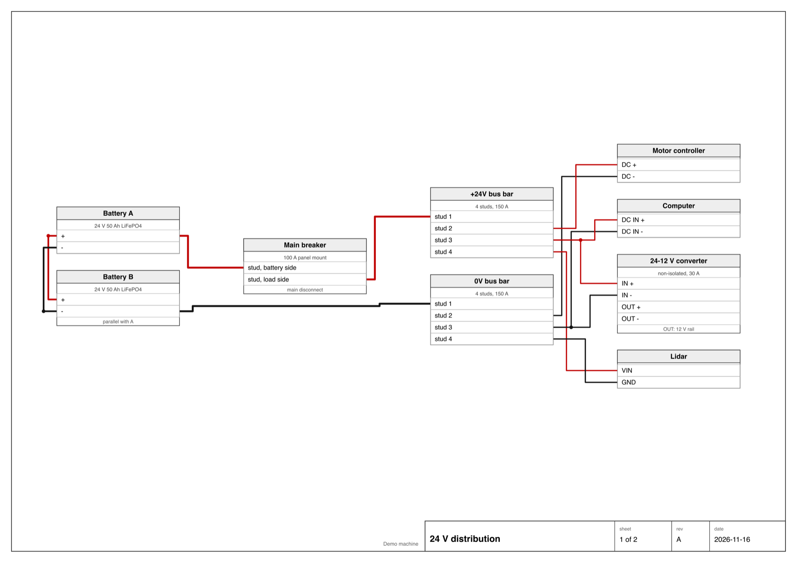

<h1 align="center">wiresheet</h1>

<p align="center"><b>Wiring sheets for machines, from a few lines of Python.</b><br>
A photo of each real part, the port names as printed on it, wires in the colour of the conductor,<br>
on a numbered page you can hand to a technician. Click a picture, land on the product page.</p>

<p align="center"></p>

<p align="center">
<code>python 3.8+</code> · <code>pure python</code> · <code>SVG / PNG / PDF</code> · <code>macOS · Linux · Windows</code>
</p>

---

## Why

Robots and other one-off machines rarely get a wiring drawing, because the tools are either
schematic capture (too abstract for "which XT30 goes where") or harness CAD (per-cable tables that
nobody reads during a walkthrough). What a handoff actually needs is the picture a good tech would
sketch on a whiteboard: boxes for the parts, the labels that are printed on them, lines between the
right terminals, nothing else.

wiresheet draws exactly that. No layout engine, no diagramming app: you list the columns in reading
order, the script computes every position on a fixed grid and writes plain SVG. librsvg turns it
into PNG and vector PDF.

## What you get

- **Boxes** with the product photo, model line, one row per port, and an optional one-line note.
- **Wires** as right-angle lines in their own tracks, longest run innermost, so they never cross.
  Shared terminals get junction dots.
- **Pages** in A3, A4, A2, Letter or Tabloid landscape, with a frame and a title block
  (title, sheet *n* of *m*, revision, date).
- **Clickable pictures**: each photo links to its product page, in the SVG and as a real link
  annotation in the PDF.
- **Files**: editable SVG, 2x PNG, vector PDF per sheet, and one merged PDF for the set.

## Install

| What | Why | How |
|---|---|---|
| Python 3.8+ | runs the script | already on your machine |
| `rsvg-convert` | PNG and PDF output | `brew install librsvg` · `apt install librsvg2-bin` |
| `pypdf` | clickable PDFs and the merged set | `pip install pypdf` |

Everything is Python or a pip package, so it runs the same on macOS, Linux and Windows. SVG output
needs nothing beyond Python itself; without pypdf you still get PNG and PDF, only without links and
without the merge. Drop `wiresheet.py` next to your script, or add this folder to `PYTHONPATH`.

## Quick start

```python
from wiresheet import Sheet, RED, BLK

s = Sheet("01-power", "Power", sheet="1 of 1", project="My robot",
          columns=[["Battery"], ["Fuse box"], ["Motor", "Lamp"]])

s.dev("Battery",  "12 V 20 Ah", "battery.jpg", ["+", "-"], link="https://shop.example/battery")
s.dev("Fuse box", "4-way",      None,          ["IN +", "IN -", "OUT 1 +", "OUT 1 -", "OUT 2 +", "OUT 2 -"])
s.dev("Motor",    "",           None,          ["+", "-"])
s.dev("Lamp",     "",           None,          ["+", "-"])

s.pair("Battery",  ["+", "-"],              "Fuse box", ["IN +", "IN -"])
s.pair("Fuse box", ["OUT 1 +", "OUT 1 -"],  "Motor",    ["+", "-"], "10 A")
s.pair("Fuse box", ["OUT 2 +", "OUT 2 -"],  "Lamp",     ["+", "-"], "2 A")

s.render()      # 01-power.svg  01-power.png  01-power.pdf
```

`examples/demo.py` builds a two-sheet set and merges it into one PDF. Run it from the `examples` folder.

## The model

A sheet is a grid. You give it the **columns in reading order**, sources on the left and loads on the
right, and inside each column the **boxes top to bottom**. That order is the whole layout. Nothing is
auto-arranged, so the drawing comes out the way you would sketch it by hand, and it stays put when
you add a part.

### Sheet

```python
Sheet(fname, title, sheet="1 of 6", columns=[[...], [...]],
      project="", rev="A", date=None, sub="",
      width=260, gap=None, page="A3", img_dir="img", out_dir=".")
```

| Argument | Meaning |
|---|---|
| `fname` | output file name, without extension |
| `title`, `sheet`, `rev`, `date` | title block; `date` defaults to today |
| `project`, `sub` | the small footer line next to the title block |
| `columns` | list of columns, each a list of box names, in reading order |
| `width` | box width in drawing pixels |
| `gap` | channel width between columns; computed from the wire count if omitted |
| `page` | `A3`, `A4`, `A2`, `Letter`, `Tabloid`, all landscape; the drawing is scaled to fit |
| `img_dir`, `out_dir` | where photos are read from and files are written to |

### Boxes

```python
s.dev(name, type_="", img=None, ports=(), note="", imgh=80, offrobot=False, link=None)
```

| Argument | Meaning |
|---|---|
| `name` | box title, and the handle wires refer to |
| `type_` | model line under the title |
| `img` | photo file in `img_dir`, embedded in the SVG; `imgh` is its height in pixels |
| `ports` | labels **as printed on the device**, top to bottom: `DC PWR  VP+`, `PoE+  RJ45`, `stud 3` |
| `note` | one short line under the ports, facts only |
| `offrobot` | draw dashed, for chargers, docks and other external equipment |
| `link` | product URL; the photo becomes clickable, or the title bar when there is no photo |

### Wires

```python
s.wire((box, port), (box, port), color=BLK, label="", width=2.5, dashed=False)
s.pair(box_a, [ports_a], box_b, [ports_b], label="", width=2.5, colors=(RED, BLK))
```

`pair` draws several conductors between the same two boxes, matched by position. Colours are hex
strings; `RED BLK BLU YEL GRN ORG GRY LGRY WHT PUR BRN` are predefined. Keep labels short: a connector
type, a gauge, a length.

## How the wires are routed

1. A wire leaves its port horizontally, turns into a vertical track in the channel between the two
   columns, runs to the height of the target port, and turns in. One SVG path: `M x y H x V y H x`.
2. Every wire in a channel gets its own track, spaced 10 px. Wires are sorted by vertical run and the
   longest takes the track nearest the source, so long runs sit inside and short ones peel off
   outside without crossing.
3. Several wires on one port share the stub out of the port and get a junction dot at each turn-off.
4. A wire between two boxes in the same column loops out on the left.
5. A wire that skips a column dips just under the boxes of that column, runs across, and comes back
   up. Use it sparingly; neighbouring columns read better.

## Conventions that read well

Learnt on real robots, not rules of the tool:

- **One device per sheet.** If a converter's input is on the power sheet, put its output on the sheet
  with the load, and write `OUT: sheet 3` in the note.
- **Terse notes.** No sentences. Open questions belong in a README next to the drawings, not on them.
- **Follow the hardware order.** List loads the way the bus bar or distribution block is numbered.
- **One rail or bus per sheet.** Six focused sheets beat one that needs a magnifier.

`Style` holds row heights, font sizes, track spacing and colours. Change the class attributes to
restyle every sheet, or pass an instance to `Sheet(style=...)` for one.

## Output

| File | Use |
|---|---|
| `name.svg` | editable in Inkscape, Illustrator, Figma; photos embedded; pictures are links |
| `name.png` | 2x raster for chat and quick viewing |
| `name.pdf` | vector page in the chosen format, with link annotations |
| `merge_pdfs(out, [pdfs])` | one PDF for the set, links preserved |

librsvg does not carry SVG links into the PDF, so after rendering the engine adds the link
annotations itself with pypdf. `merge_pdfs` uses pypdf too and keeps them.

## Layout

```
wiresheet.py          the whole engine, one file
examples/demo.py      two-sheet example
examples/img/         photos for the example (empty, add your own)
docs/example.png      the image at the top of this file
```

## Scope

wiresheet is for the **system level**: which part connects to which, on which terminal. For the
**harness level**, wire by wire with gauges, lengths and a bill of materials per cable,
[WireViz](https://github.com/wireviz/WireViz) is the right tool, and the two sit well side by side.
