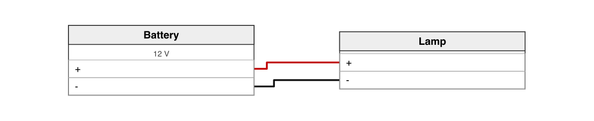
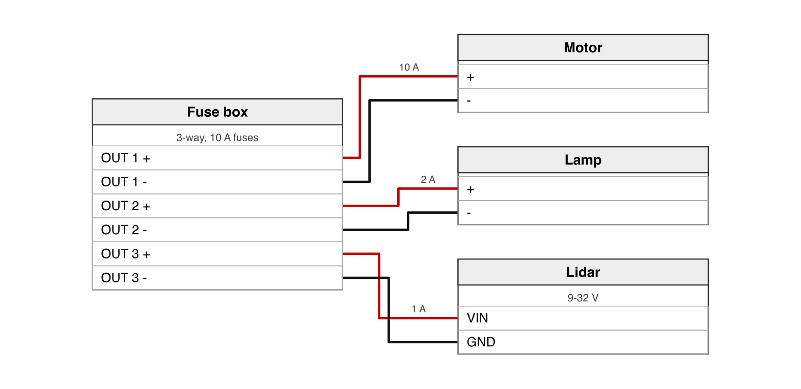
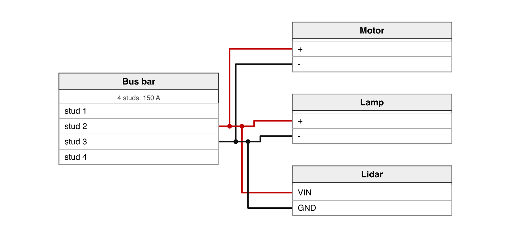
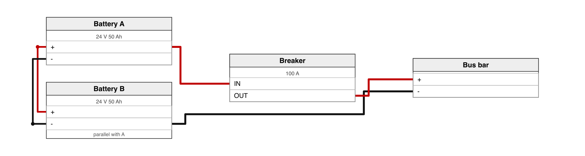
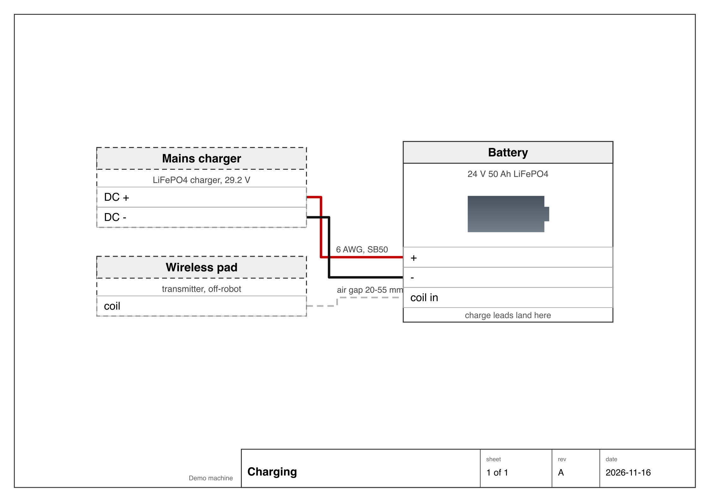

# wiresheet in five drawings

Every example is the complete code: run it and you get the picture under it. The first four use
`page="fit"`, which renders just the drawing; the last one is a real A4 page.
Generated by `examples/tutorial.py`, so the code and the pictures always match.

## One wire

The two lists in `columns` are the whole layout. `["Battery"]` is column 0 on the left, `["Lamp"]` is
column 1 to its right. Each `dev` declares a box: title, model line, photo (none here), and the port
rows top to bottom. A `wire` names a port on each end. The wire leaves the Battery on its right edge,
runs in the channel between the columns, and enters the Lamp on its left edge.

```python
s = Sheet("01-one-wire", "One wire", page="fit", columns=[["Battery"], ["Lamp"]])
s.dev("Battery", "12 V", None, ["+", "-"])
s.dev("Lamp", "", None, ["+", "-"])
s.wire(("Battery", "+"), ("Lamp", "+"), RED)
s.wire(("Battery", "-"), ("Lamp", "-"), BLK)
```



## A column of loads

Order inside a column is top to bottom, exactly as written: Motor, then Lamp, then Lidar. `pair` draws
several conductors between the same two boxes in one call, red and black by default, with the label on
the first one. Every wire in the channel gets its own vertical track. The longest run (to the Lidar)
takes the track nearest the fuse box, shorter runs sit further out, so nothing crosses.

```python
s = Sheet("02-column", "A column of loads", page="fit",
          columns=[["Fuse box"], ["Motor", "Lamp", "Lidar"]])
s.dev("Fuse box", "3-way, 10 A fuses", None,
      ["OUT 1 +", "OUT 1 -", "OUT 2 +", "OUT 2 -", "OUT 3 +", "OUT 3 -"])
s.dev("Motor", "", None, ["+", "-"])
s.dev("Lamp", "", None, ["+", "-"])
s.dev("Lidar", "9-32 V", None, ["VIN", "GND"])
s.pair("Fuse box", ["OUT 1 +", "OUT 1 -"], "Motor", ["+", "-"], "10 A")
s.pair("Fuse box", ["OUT 2 +", "OUT 2 -"], "Lamp", ["+", "-"], "2 A")
s.pair("Fuse box", ["OUT 3 +", "OUT 3 -"], "Lidar", ["VIN", "GND"], "1 A")
```



## Shared terminals

Three loads hang off the same two studs. Wires that leave one port share the stub out of that port,
and a junction dot marks every point where one of them turns off into its own track. Swap the order of
`"Motor"`, `"Lamp"`, `"Lidar"` in the column and only the stacking changes; the tracks are re-assigned
by the same rule.

```python
s = Sheet("03-shared", "Shared terminals", page="fit",
          columns=[["Bus bar"], ["Motor", "Lamp", "Lidar"]])
s.dev("Bus bar", "4 studs, 150 A", None, ["stud 1", "stud 2", "stud 3", "stud 4"])
s.dev("Motor", "", None, ["+", "-"])
s.dev("Lamp", "", None, ["+", "-"])
s.dev("Lidar", "", None, ["VIN", "GND"])
for load, p, n in [("Motor", "+", "-"), ("Lamp", "+", "-"), ("Lidar", "VIN", "GND")]:
    s.wire(("Bus bar", "stud 2"), (load, p), RED)
    s.wire(("Bus bar", "stud 3"), (load, n), BLK)
```



## Same column, skipped column

Two special routes. A wire between boxes in the **same column** loops out on the left side, like the
parallel links between the batteries. A wire whose ends are **not in neighbouring columns** dips just
under the boxes of the column in between, like the black lead from Battery B that bypasses the breaker
column on its way to the bus bar. Both work, but a drawing reads best when most wires join neighbours.

```python
s = Sheet("04-loops", "Same column, skipped column", page="fit",
          columns=[["Battery A", "Battery B"], ["Breaker"], ["Bus bar"]])
s.dev("Battery A", "24 V 50 Ah", None, ["+", "-"])
s.dev("Battery B", "24 V 50 Ah", None, ["+", "-"], "parallel with A")
s.dev("Breaker", "100 A", None, ["IN", "OUT"])
s.dev("Bus bar", "", None, ["+", "-"])
s.wire(("Battery A", "+"), ("Battery B", "+"), RED, "", 3.5)      # same column
s.wire(("Battery A", "-"), ("Battery B", "-"), BLK, "", 3.5)      # same column
s.wire(("Battery A", "+"), ("Breaker", "IN"), RED, "", 4)
s.wire(("Breaker", "OUT"), ("Bus bar", "+"), RED, "", 4)
s.wire(("Battery B", "-"), ("Bus bar", "-"), BLK, "", 4)          # skips the breaker column
```



## Photos, links, notes, a real page

The last example renders a real page instead of `fit`: A4 landscape with a frame and a title block
filled from `title`, `sheet`, `rev` and `date`, and `project` in the footer. The battery has a photo
from `img_dir`, a one-line `note`, and a `link`, so clicking the picture in the SVG or PDF opens the
product page. The charger is `offrobot=True` and drawn dashed. Wires can be dashed too, here for the
air gap of a wireless charger, and colours are any hex string.

```python
s = Sheet("05-page", "Charging", sheet="1 of 1", project="Demo machine", rev="A", date="2026-11-16",
          page="A4", img_dir=IMG,
          columns=[["Mains charger", "Wireless pad"], ["Battery"]])
s.dev("Mains charger", "LiFePO4 charger, 29.2 V", None, ["DC +", "DC -"], offrobot=True)
s.dev("Wireless pad", "transmitter, off-robot", None, ["coil"], offrobot=True)
s.dev("Battery", "24 V 50 Ah LiFePO4", "placeholder-battery.png", ["+", "-", "coil in"],
      "charge leads land here", imgh=70, link="https://example.com/battery")
s.pair("Mains charger", ["DC +", "DC -"], "Battery", ["+", "-"], "6 AWG, SB50", 3)
s.wire(("Wireless pad", "coil"), ("Battery", "coil in"), "#b5b5b5", "air gap 20-55 mm", 2, dashed=True)
```



## Where to go from here

- Put sources on the left and loads on the right, and order loads the way the bus bar or fuse block is numbered.
- One rail or one bus per sheet. Several small sheets beat one large one.
- Use the port names printed on the device, not names you invent.
- Keep open questions in a README next to the drawings, not on them.

The full argument reference is in the [README](../README.md).
